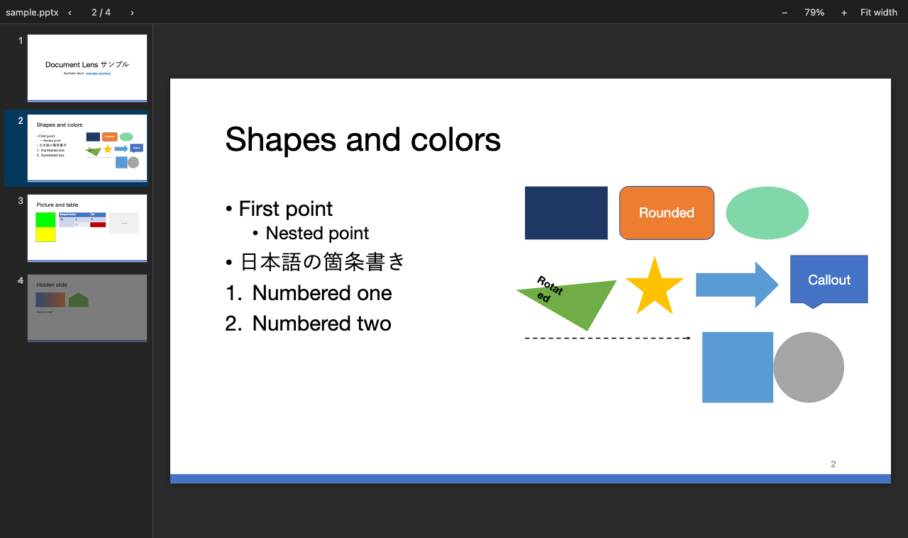
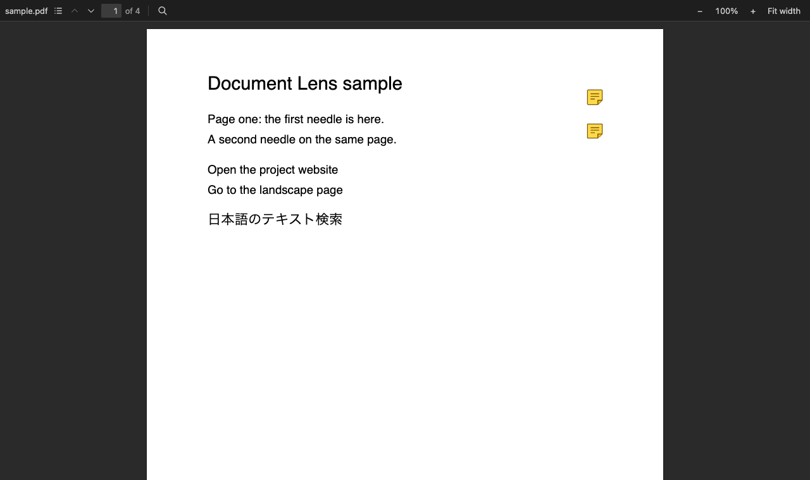
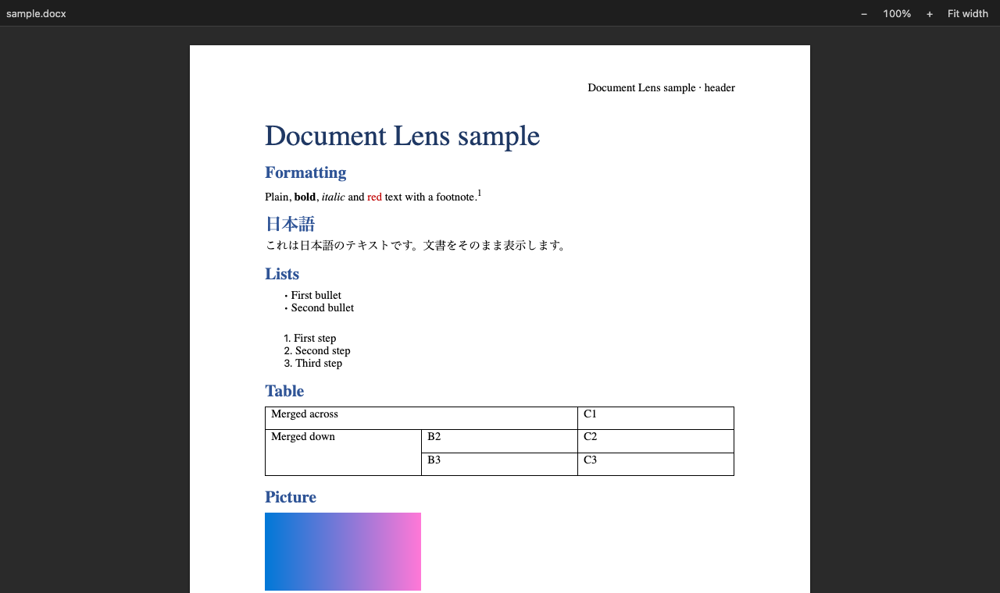
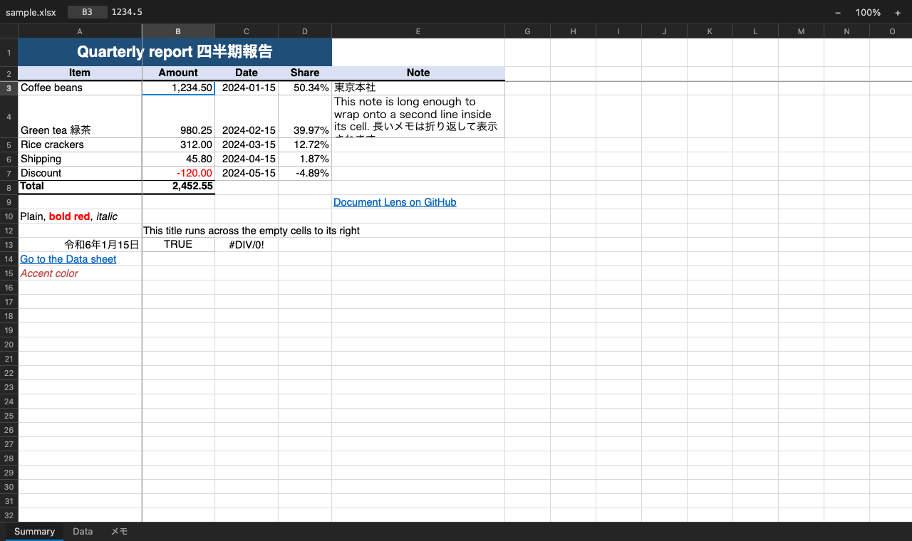

# Document Lens

Open `.pdf`, `.docx`, `.doc`, `.xlsx`, `.xls`, `.pptx` and `.ppt` files right inside VS Code. Pages, sheets and
slides open read-only in an editor tab, next to your code. Everything is rendered locally: nothing is uploaded and no
other application is needed.



## Features

- **One click to open:** supported files open in Document Lens by default, like images do.
- **Offline and private:** files never leave your machine, and the viewers make no network requests.
- **Follows your files:** the view reloads by itself when the file changes on disk and keeps your page, zoom and
  scroll position.
- **Japanese and other CJK text** in every format.
- **Shared controls:** zoom with the toolbar, `+` / `-` / `0`, or Ctrl/Cmd + scroll (pinch on a trackpad). Links in
  a document open in your browser (http and https only).
- **Safe with untrusted files:** malformed, oversized or suspicious files (for example ZIP bombs) are refused with a
  message instead of freezing VS Code.

| Extension | What you see |
| --- | --- |
| `.pdf` | Pages with selectable text, page navigation, find, outline, links, zoom and fit width |
| `.docx` | The document laid out as pages: headers, footers, footnotes, pictures, tables, lists and embedded fonts |
| `.xlsx`, `.xls` | Sheets in a grid: merged cells, column widths, frozen panes, fills, fonts, borders, number and date formats, links |
| `.pptx` | Slide list and slide view: shapes, text, pictures and tables in their theme colors |
| `.doc` | Simplified preview: the text with tables, links, footnotes, comments, headers and footers |
| `.ppt` | Simplified preview: each slide's title, text and pictures |

## .pdf



- Only the pages near the view are drawn, so files with thousands of pages open quickly.
- Select and copy text; find with Ctrl/Cmd + F, including Japanese input.
- The outline panel lists the document's bookmarks; internal links jump to their page.
- Scanned pages (JBIG2, CCITT fax, JPEG 2000) and the standard PDF fonts work without a network connection.
- Password-protected files show a message (no password prompt yet).

## .docx and .doc



- `.docx`: white pages with styles, headers and footers, footnotes, pictures, tables, lists and fonts embedded in the
  file. Bookmarks inside the document scroll to their target; pictures linked from the web are not loaded.
- `.doc` (the older binary format): a simplified preview of the text, with tables, page breaks, links, footnotes,
  comments, headers and footers. Formatting and pictures are not shown, and a banner says so. Tracked deletions and
  hidden text are left out.
- Both support VS Code's find (Ctrl/Cmd + F) and Fit width.

## .xlsx and .xls



- Sheet tabs, merged cells, column widths and row heights, frozen panes, fills, fonts, borders, alignment and wrap.
- Number and date formats as the file defines them, including Japanese eras.
- The bar at the top shows the selected cell's address and its formula or value; copy a cell with Ctrl/Cmd + C.
- Sheets with hundreds of thousands of rows scroll smoothly.
- Formulas show the values saved in the file; they are not recalculated. Pictures, charts and comments are not shown.

## .pptx and .ppt

- `.pptx`: a list of slide thumbnails and the current slide fitted to the window. Shapes, text, pictures, tables and
  groups are drawn with the theme's colors and the master and layout styles. Charts, embedded objects, video and
  audio appear as labelled placeholders. Hidden slides are marked.
- `.ppt` (the older binary format): a simplified preview with each slide's title, text and pictures; layout and
  shapes are not shown, and a banner says so.

## Keyboard shortcuts

| Where | Key | Action |
| --- | --- | --- |
| All | `+` / `-` / `0` | Zoom in / out / 100% |
| All | Ctrl/Cmd + scroll, pinch | Zoom |
| `.pdf`, `.docx`, `.doc`, `.pptx` | `W` | Fit width (`.pptx`: fit the slide) |
| PDF | Ctrl/Cmd + F, then Enter / Shift + Enter, Esc | Find, next / previous match, close |
| PDF | Ctrl/Cmd + G, F3 | Next match |
| `.pptx` | ← / →, PageUp / PageDown, Home / End | Previous / next, first / last slide |
| `.xlsx`, `.xls` | Arrow keys, PageUp / PageDown, Home / End | Move the selection |
| `.xlsx`, `.xls` | Ctrl/Cmd + C | Copy the selected cell |
| `.docx`, `.doc`, `.ppt` | Ctrl/Cmd + F | VS Code's find |

## Using another editor for a file type

Right-click a file → **Open With…** → pick an editor, or **Configure default editor for '\*.pdf'…** to change the
default. You can also set it in your settings:

```json
"workbench.editorAssociations": {
  "*.pdf": "default"
}
```

## Privacy and security

- Files are read through VS Code and rendered inside the editor's webview. Nothing is sent anywhere.
- The viewers run under a strict Content Security Policy: no network access, no scripts from the document, only the
  extension's own code. Links open in your browser only after you click them, and only for http and https.
- Before a file reaches a viewer, its size and structure are checked. Larger files are refused: `.pdf` 256 MB,
  `.pptx` 200 MB, `.ppt` 128 MB, `.docx` and `.xlsx` 100 MB, `.doc` and `.xls` 64 MB. PDFs with more than 50,000
  pages are refused too.

## Limitations

- Read-only: documents cannot be edited or saved.
- Fonts that are not installed are replaced by similar ones, so line breaks can differ from the original application.
- `.docx`: pages break only where the document has page breaks; page numbers in headers and footers are not filled
  in.
- `.xlsx`, `.xls`: no pictures, charts, comments, conditional formatting or data validation.
- `.pptx`: no animations, transitions, notes, 3D effects or WordArt; charts and SmartArt without a stored drawing are
  placeholders.
- `.doc`, `.ppt`: text and pictures only. Files saved by versions from 1995 and earlier are refused with a message.

## Install

Search for **Document Lens** in the Extensions view, or run:

```bash
code --install-extension thai1108.document-lens
```

To install a downloaded `.vsix` (also attached to each
[GitHub release](https://github.com/thai1108/vscode-document-lens/releases)):

```bash
code --install-extension document-lens-0.1.0.vsix
```

## Development

### Build from source

Requires Node.js 22.18 or later (the tests and scripts run TypeScript directly) and pnpm 10.

```bash
corepack enable                    # provides the pnpm version pinned in package.json
pnpm install
pnpm package                       # runs all checks, writes document-lens-<version>.vsix
code --install-extension document-lens-0.1.0.vsix
```

### Commands

```bash
pnpm watch                        # rebuild on change, then F5 in VS Code to launch the extension host
pnpm check                        # type-check, lint, fast tests (node:test + happy-dom), build
pnpm coverage                     # fast tests with Node's built-in coverage report
pnpm test:e2e                     # Playwright in the installed Google Chrome against the browser preview
pnpm test:vscode                  # extension tests inside VS Code (uses the installed app if found)
pnpm fixtures <dir>               # write the synthetic sample of every format
pnpm preview <file> <dir>         # static browser copy of the viewer for one file, for UI checks
```

- `pnpm test:e2e` opens the synthetic sample of every format through `pnpm preview`, whose mock host replays VS
  Code's message serializer, and fails on console or CSP errors. To run the same checks on your own documents, list
  them in `E2E_FILES`, separated by `:` — e.g. `E2E_FILES="$HOME/a.pdf:$HOME/b.xlsx" pnpm test:e2e`. It needs
  Google Chrome; no Playwright browser download is required.
- `pnpm test:vscode` checks that every format opens in its Document Lens editor by default and that files are read
  with the size cap and checks applied. Set `VSCODE_EXECUTABLE` to use a specific VS Code build; without it and
  without `/Applications/Visual Studio Code.app`, a copy of VS Code is downloaded.
- `pnpm preview` and `E2E_FILES` copy the document into the preview folder; keep real documents out of the repository.

### How it works

The extension host reads the file (refusing it above the format's size cap), runs a cheap structural check
(`src/preflight.ts`: file signature; for `.docx`/`.xlsx`/`.pptx` the ZIP central directory against the limits in
`src/limits.ts`) and posts the bytes to the webview as a plain `Uint8Array`. The viewer parses and renders them inside
the webview, which runs under a strict Content Security Policy: no network, no inline scripts, only the extension's
own bundle. Messages from the webview are validated in `src/protocol.ts`.

### Adding a format

1. Add its size cap to `MAX_FILE_SIZE` in `src/limits.ts`.
2. Describe it in `src/formats/<id>.ts` (`id`, extensions, size cap, viewer bundle name, extra CSP sources if the
   viewer needs any, preflight check) and add it to `FORMATS` in `src/formats/index.ts`.
3. Declare the custom editor `documentLens.<id>` with the same file patterns in `package.json`.
4. Write the viewer in `src/webview/<viewer>/main.ts`: call `startViewer()` from `src/webview/shell/app.ts` with an
   object whose `render()` turns the bytes into DOM inside `context.content`. Treat the file as hostile: no script
   execution, sanitize any HTML a library produces, no remote loads. Bundle options the viewer needs (loaders,
   plugins) go in `src/webview/<viewer>/build.mjs`, merged over the defaults in `esbuild.mjs`.
5. Add a synthetic sample in `test/fixtures/<id>.ts` (generated by code, never a real document) and tests at every
   layer: unit, happy-dom (`test/webview`), Playwright (`test/e2e/<viewer>.spec.ts`) and VS Code
   (`test/vscode/<viewer>.suite.ts`).

`pnpm test` fails if the registry, `package.json`, the viewer bundles and the samples get out of step.

### Releasing

1. Bump `version` in `package.json` and add a matching `## <version>` section to `CHANGELOG.md`; merge to `main`.
2. Push a tag `v<version>` (e.g. `git tag v0.1.0 && git push origin v0.1.0`). The *Release* workflow checks that the
   tag matches `package.json`, runs `pnpm check` and `pnpm package`, and creates a GitHub Release with the `.vsix`
   attached and the CHANGELOG section as notes.
3. Download the `.vsix` from the release and upload it to the Marketplace by hand.

## Third-party software

The viewers bundle pdf.js, docx-preview, JSZip, pako and SheetJS Community Edition. Their license texts ship with the
extension next to the viewer bundles (`dist/webview-*.licenses.txt` and `dist/webview-spreadsheet.LICENSES.txt`).

## Trademarks

Microsoft, Word, Excel and PowerPoint are trademarks of the Microsoft group of companies; Adobe and Acrobat are
trademarks of Adobe Inc. This project is an independent viewer for the file formats listed above and is not
affiliated with, sponsored or endorsed by Microsoft or Adobe. The icon is original artwork.

## License

[MIT](LICENSE)
